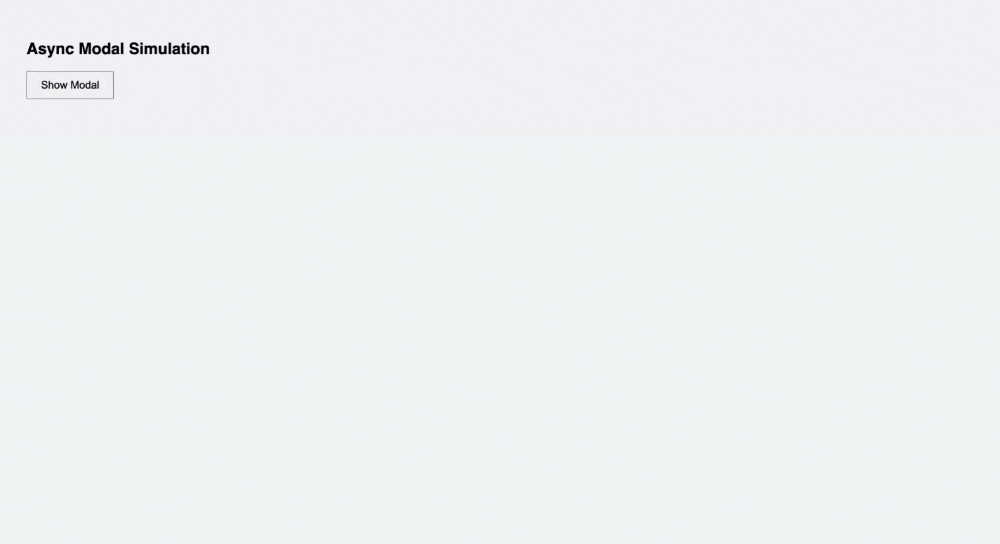
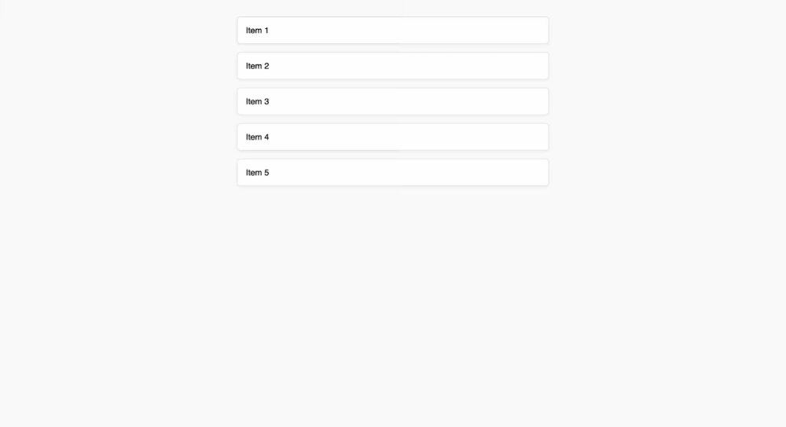

<h1>
  Pre-Selenium: Dynamic Content with JavaScript
  Asynchronous Content Loading Patterns
</h1>

**Learning Objective:** Identify real-world examples of asynchronously loaded content (such as search results, modals, or API-driven data).

## Asynchronous loading patterns in modern web design

Modern web applications often act more like interactive tools than like static documents. This interactivity is made possible by _asynchronous loading_, which means some parts of the webpage can update, appear, or disappear at any moment—often as a response to your actions or after new data arrives from the server. These updates happen thanks to JavaScript, creating the experience of a page that is always adapting to your needs.

Unlike traditional, static webpages where every element is delivered when the page first loads, dynamic pages update only specific portions as necessary. This makes them feel fast and smooth for users. However, it also means that the page structure—called the _Document Object Model_ or _DOM_—can change at any time. As an automation tester, especially one preparing to use Selenium, this creates unique challenges since elements sometimes exist only _after_ certain actions or server responses.

Let's look at common real-world patterns where asynchronous loading occurs, see how to recognize the visual and technical cues, and understand the specific challenges these patterns create for automation.

## Example 1: Search results that load after user input

Think about when you search for a product on an international e-commerce site or enter a destination in a travel search engine. As you type in the search box, suggestions or search results often appear right below the box—sometimes even updating with every keystroke.

What's happening behind the scenes?

- Each time you type, JavaScript sends your input to the server (using a method called AJAX).
- The server responds with a list of matches or suggestions.
- The browser shows a spinner or placeholder while waiting for data.
- Once data arrives, search results appear instantly below the search bar, all without reloading the page.

**Visual cues:**

- A loading spinner or "searching" message appears below the search bar.
- Results fade in or slide into view after a slight delay.
- The list updates as you keep typing different input.

> 💡 A live search box works like a helpful assistant who waits until you stop speaking, quickly gets what you need, then slides the result sheet in front of you—all while you stay in place.

 

**Automation challenge:**  
If an automated script tries to select a search result before new options have been loaded, it will not find the elements it expects and the test may fail with an “element not found” error.

## Example 2: Modal windows and pop-ups triggered asynchronously

Modal windows (pop-ups that appear on top of the main page) are common for actions such as signing in, viewing extra details, or responding to notifications. When a user clicks a button to open a modal, the overlay might appear instantly—but the content inside, such as a login form or extra details, is often fetched asynchronously.

How does this look in practice?

- You click a button, and a modal overlay appears.
- The modal might be empty at first, showing a spinner or "loading" text.
- Data (such as user information or product details) is then loaded from the server.
- The real content replaces the spinner after a short wait.

**Visual cues:**

- The modal overlay appears immediately, but the main content inside takes longer, sometimes showing a spinner or a grey placeholder ("skeleton screen") first.
- Sometimes only partial content shows up, with other sections fading in once loaded.

 

**Automation challenge:**  
Automated tests might attempt to fill in or interact with a form before the server has sent the necessary fields. This can lead to failures because the expected elements are not yet in the DOM.

## Example 3: Infinite scrolling and lazy loading patterns

Many sites today—such as news feeds, search pages, or product galleries—use _infinite scrolling_ rather than "Next" buttons. As you scroll, new items load automatically. Similarly, images might not load until you actually scroll them into view; this is called _lazy loading_.

Here's what happens behind the scenes:

- The page loads a first batch of content.
- As you scroll near the bottom, JavaScript detects your position and asks the server for more content.
- New items, such as additional articles or products, slide or fade into place as they are fetched.
- With lazy loading, images remain blank or show a placeholder until you actually scroll them into view.

**Visual cues:**

- Spinners, “loading more” bars, or grey placeholders at the end of a list.
- New items suddenly appear after a brief delay as you scroll.
- Images gradually become clear as they are revealed.

 

**Automation challenge:**  
If a test script expects all items to be available upon page load, but additional items only appear after scrolling, tests that try to interact with those items will fail unless the script triggers scrolling and waits for data.

## Example 4: Real-time updates driven by API calls

Some websites update their information in real time, displaying things like chat messages, live sports scores, or status notifications—often without any direct action from the user.

Typical flow:

- The site periodically checks the server for new data, or listens for notifications.
- When new data arrives, JavaScript updates the relevant portion of the DOM instantaneously.
- Sections may briefly display “updating…” or show a spinner before the new information appears.

**Visual cues:**

- Updates or new messages appear on their own, without the user doing anything.
- Small spinners or temporary “connecting” messages show up just before new info arrives.
- The new content fades into view or appears highlighted to grab your attention.

> ♻️ These patterns are especially common in collaborative apps, dashboards, or any experience where users expect to see changes as soon as they occur.

 

**Automation challenge:**  
Because updates are unpredictable, an automation script could be waiting for a message or update to appear at a certain moment, but the timing can vary due to network speed or server response, making the tests inconsistent unless properly managed.

## Using Chrome DevTools to inspect network activity and capture asynchronous events

While spotting visual cues lets you guess when content is dynamically loaded, Chrome DevTools reveals exactly when and how asynchronous actions happen.

Here’s how you can use DevTools for this:

1. **Open DevTools:**  
   Right-click anywhere on a webpage and select **Inspect** or press <kbd>Ctrl</kbd> + <kbd>Shift</kbd> + <kbd>I</kbd> (<kbd>Cmd</kbd> + <kbd>Option</kbd> + <kbd>I</kbd> on Mac).

2. **Go to the Network panel:**  
   This panel logs every request your browser makes to the server—main page loads, API calls, and background data fetching.

3. **Trigger a dynamic action:**  
   For example, type in a search box, click a button, or scroll down to load more content.

4. **Watch for new requests:**  
   Look for entries labeled as `XHR` or `Fetch`. These are common signs that JavaScript is asking the server for new data.

5. **Match requests to UI changes:**  
   Notice if new content appears just as one of these network requests finishes. This confirms that the page relies on asynchronous loading for that section.

> 🧠 This technique is a key debugging skill: you can connect the dots between user actions, network traffic, and visual changes—crucial for building reliable automation scripts.

## Reminder: use visual cues such as loading spinners and placeholder content

Websites help users understand what is happening in the background through visual feedback, such as spinners, skeleton screens, or loading messages.

**Common cues to watch for:**

- **Loading spinners:** Moving icons or animations that indicate the page is fetching data.
- **Skeleton screens:** Grey or colored placeholders shaped like text or images, replaced by real content when available.
- **Temporary messages:** Phrases like "Loading...", "Please wait", or "Fetching data..." that vanish when content appears.
- **Blurry or faded areas:** Page sections may be blurred or slightly transparent until the real content loads in.

> 💡 When you notice these cues as a user, you’re actually catching asynchronous loading _in action_. Recognizing these as a tester lets you anticipate when your scripts might need to wait before interacting with new elements.

## Knowledge check

❓ Which of the following is a clear visual indicator that content is being loaded asynchronously?

- A) The entire web page instantly appears after you load the site.
- B) A loading spinner or skeleton screen appears before new content is displayed.
- C) Nothing on the page changes, even after user interaction.
- D) The browser reloads the entire page with every search or scroll.

❓ When reviewing network activity in Chrome DevTools, which types of requests often signal asynchronous content loading?

- A) Image and font file downloads
- B) XHR and Fetch requests
- C) Only page reloads (document requests)
- D) Offline resources
